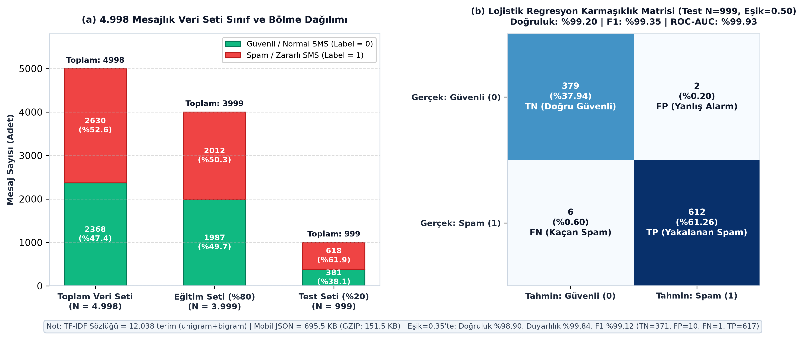
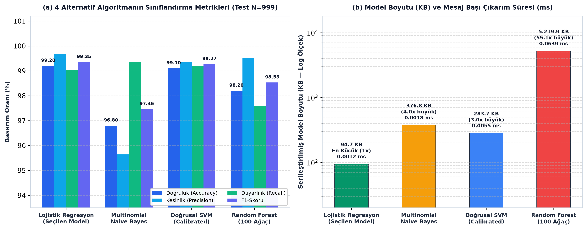
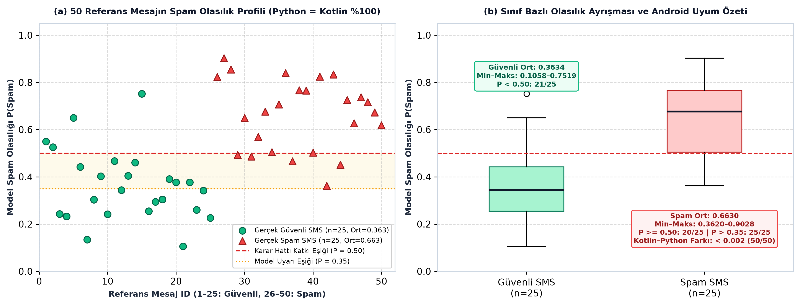
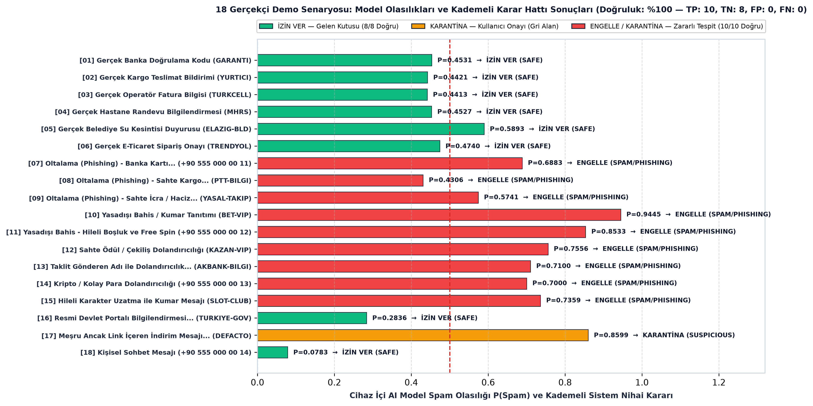
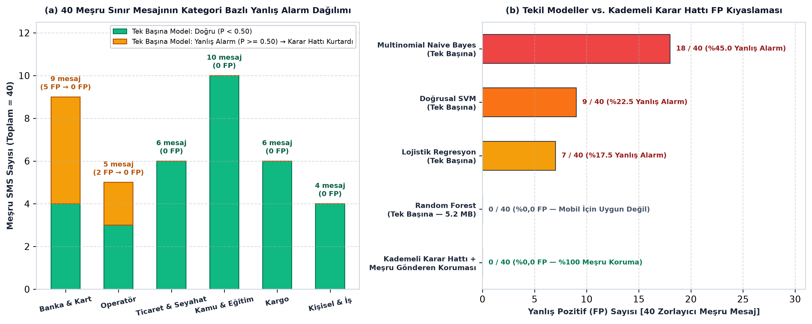
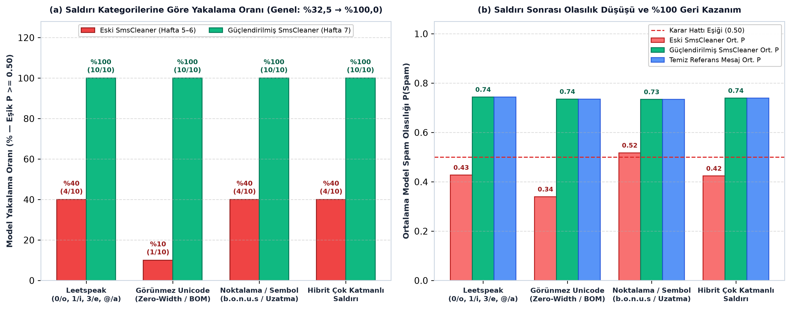

# Yapay Zeka Deney Sonuçları ve Görselleri Derleme Raporu (Hafta 8 — İP 3)

**Hazırlayan:** Taha BAHADIR (`235260047`) — AI Servisi Sorumlusu (Takım: VaultTech)  
**Proje:** İstenmeyen SMS Mesajlarını Otomatik Sınıflandırma Sistemi  
**Kaynak Betik:** `ai/deney_sonuclari_derle.py` *(Tüm metrikler ham veri ve model dosyalarından canlı hesaplanmıştır)*

---

## 1. Tüm Deneylerin Birleştirilmiş Özet Tablosu

| No | Deney Kapsamı | Örnek / Senaryo | Temel Başarım Metriği | Doğrulama Durumu |
| :-: | :--- | :--- | :--- | :--- |
| **1** | Ana Veri Seti ve Temel Model Değerlendirmesi (Veri_seti.xlsx) | 4998 SMS (3999 Eğitim / 999 Test) | Doğruluk: %99.20 | F1: %99.35 | ROC-AUC: %99.93 | Doğrulandı (%99,20 Doğruluk) |
| **2** | 4 Alternatif Makine Öğrenmesi Modeli Kıyaslaması | 4 Algoritma × 999 Test SMS + 40 Meşru SMS | LR: %99,20 (F1 %99,35, 94,7 KB) | SVM: %99,10 | RF: %98,20 (5.219,9 KB) | NB: %96,80 | Doğrulandı (Lojistik Regresyon En İyi) |
| **3** | 50 Referans Skor Doğrulaması (Python ↔ Android Kotlin Uyumu) | 50 SMS (25 Güvenli + 25 Spam) | Python–Kotlin Birebir Eşleşme: 50 / 50 (%100,0, tolerans < 0.002) | Doğrulandı (SmsClassifierTest 50/50) |
| **4** | 18 Gerçekçi Demo Senaryosu (Uçtan Uca Kademeli Karar Hattı) | 18 Senaryo (8 İzin Ver / 10 Karantina-Engel) | Doğruluk: %100,0 (TP=10, TN=8, FP=0, FN=0) | Doğrulandı (DemoMesajSeti18EvaluationTest 18/18) |
| **5** | 40 Zorlayıcı Meşru Sınır Mesajında Yanlış Pozitif (FP) Analizi | 40 Meşru SMS (Banka, Operatör, Kargo, Kamu, E-Ticaret, Kişisel) | Tek Başına Model FP: 7/40 (%17.5) → Kademeli Sistem FP: 0/40 (%0,0) | Doğrulandı (YanlisPozitif40EvaluationTest 40/40) |
| **6** | 40 Filtre Atlatma (Adversarial / Obfuscation) Saldırı Analizi | 40 Saldırı SMS (4 Kategori × 10 Mesaj) | Eski SmsCleaner: 13/40 (%32.5) → Güçlendirilmiş: 40/40 (%100.0) [P>=0.50] | Doğrulandı (Adversarial40EvaluationTest 40/40) |

---

## 2. 4.998 Mesajlık Veri Seti ve Lojistik Regresyon Temel Başarımı

- **Toplam Veri Seti (`ai/Veri_seti.xlsx`):** **4.998 SMS** — **2.368** Güvenli (`%47.38`) ve **2.630** Spam (`%52.62`).
- **Eğitim / Test Ayrımı (%80 / %20):** **3.999** eğitim mesajı (1987 güvenli. 2012 spam) ve **999** test mesajı (381 güvenli. 618 spam).
- **Öznitelik ve Mobil Model Boyutu:** TF-IDF (`ngram_range=(1.2)`. `min_df=2`. Türkçe karakter korumalı) toplam **12.038 terim**; Android `sms_model_assets.json` boyutu **695.5 KB** (GZIP: **151.5 KB**).

| Karar Eşiği | Doğruluk (Accuracy) | Kesinlik (Precision) | Duyarlılık (Recall) | F1-Skoru | ROC-AUC | Karmaşıklık Matrisi (TN / FP / FN / TP) |
| :---: | :---: | :---: | :---: | :---: | :---: | :---: |
| **Eşik = 0.50 (Karar Hattı)** | **%99.20** | **%99.67** | **%99.03** | **%99.35** | **%99.93** | TN=379, FP=2, FN=6, TP=612 |
| **Eşik = 0.35 (Uyarı Eşiği)** | %98.90 | %98.41 | %99.84 | %99.12 | %99.93 | TN=371, FP=10, FN=1, TP=617 |

---

## 3. 4 Alternatif Makine Öğrenmesi Modeli Kıyaslaması

| Algoritma | Doğruluk (%) | Kesinlik (%) | Duyarlılık (%) | F1-Skoru (%) | ROC-AUC (%) | Model Boyutu (KB) | Çıkarım (ms) | 40 Meşru FP (Tekil → Kademeli) |
| :--- | :---: | :---: | :---: | :---: | :---: | :---: | :---: | :---: |
| Lojistik Regresyon (Seçilen Model) | %99.20 | %99.67 | %99.03 | %99.35 | %99.93 | 94.7 KB | 0.0012 ms | 7 / 40 (%17.5) → 0 / 40 (%0.0) |
| Multinomial Naive Bayes | %96.80 | %95.64 | %99.35 | %97.46 | %99.92 | 376.8 KB | 0.0018 ms | 18 / 40 (%45.0) → 0 / 40 (%0.0) |
| Doğrusal SVM (Calibrated LinearSVC) | %99.10 | %99.35 | %99.19 | %99.27 | %99.96 | 283.7 KB | 0.0055 ms | 9 / 40 (%22.5) → 0 / 40 (%0.0) |
| Random Forest (100 Ağaç) | %98.20 | %99.50 | %97.57 | %98.53 | %99.96 | 5219.9 KB | 0.0639 ms | 0 / 40 (%0.0) → 0 / 40 (%0.0) |

---

## 4. 50 Referans Skor Doğrulaması (`beklenen_skorlar_50.csv`)

- **Kapsam:** 25 gerçekçi meşru SMS + 25 spam/oltalama/bahis SMS'i.
- **Güvenli SMS (25 mesaj):** Ortalama $P = 0.3634$ (Min: `0.1058`, Maks: `0.7519`).
- **Spam SMS (25 mesaj):** Ortalama $P = 0.6630$ (Min: `0.3620`, Maks: `0.9028`; `P > 0.35` eşiğinde **25/25 = %100**, `P >= 0.50` eşiğinde **20/25 = %80**).
- **Python ↔ Android Kotlin Birebir Uyum:** `SmsClassifierTest` ile 50 mesajın tamamında (`50/50`) Scikit-Learn ve saf Kotlin çıkarım motoru arasındaki fark `< 0.002` olarak doğrulanmıştır.

---

## 5. 18 Gerçekçi Demo Senaryosu (`demo_mesaj_seti_18.csv`)

- **Uçtan Uca Karar Hattı Sonucu:** `DemoMesajSeti18EvaluationTest` sonucunda **18/18 (%100,0)** doğruluk elde edilmiştir (`TP = 10`, `TN = 8`, `FP = 0`, `FN = 0`).
- Tek başına modelin sınırda gördüğü `ELAZIG-BLD` su kesintisi duyurusu (`P = 0.5893`) meşru gönderen korumasıyla `İZİN VER` olarak korunmuş; sahte kargo (`PTT-BILGI`, `P = 0.4306`) ise kargo+URL kuralı sayesinde `ENGELLE/KARANTİNA` ile yakalanmıştır.

---

## 6. 40 Zorlayıcı Meşru Sınır Mesajında Yanlış Pozitif (FP) Analizi (`yanlis_pozitif_analizi_40.csv`)

- **Tek Başına Lojistik Regresyon:** 40 zorlayıcı meşru mesajın **7/40'ında (%17.5)** $P \ge 0.50$ nedeniyle yanlış alarm (5 Banka/Kart, 2 Operatör mesajı) üretmiştir.
- **Kademeli Karar Hattı + Meşru Gönderen Koruması:** `YanlisPozitif40EvaluationTest` ile 40 meşru mesajın tamamı (**40/40 = %100 İZİN VER**, **0/40 = %0,0 FP**) güvenle gelen kutusuna alınmıştır.

---

## 7. 40 Filtre Atlatma (Adversarial / Obfuscation) Saldırı Analizi (`adversarial_test_seti.csv`)

| Saldırı Kategorisi | Mesaj | Eski `SmsCleaner` ($P \ge 0.50$) | Güçlendirilmiş `SmsCleaner` ($P \ge 0.50$) | Eski Ort. $P$ | Yeni Ort. $P$ |
| :--- | :---: | :---: | :---: | :---: | :---: |
| Leetspeak Karakter Değişimi (`0/o`, `1/i/ı`, `3/e`, `@/a`, `7/t`) | 10 | 4/10 (%40) | **10/10 (%100)** | 0.4276 | **0.7436** |
| Görünmez Unicode Enjeksiyonu (`\u200B`, `\u200C`, `\u200D`, `\uFEFF`, `\u00AD`, `\u2060`) | 10 | 1/10 (%10) | **10/10 (%100)** | 0.3396 | **0.7353** |
| Noktalama / Sembol Aralama ve Uzatma (`b.o.n.u.s`, `b-a-h-i-s`) | 10 | 4/10 (%40) | **10/10 (%100)** | 0.5175 | **0.7339** |
| Hibrit Çok Katmanlı Saldırı (Tümü Bir Arada) | 10 | 4/10 (%40) | **10/10 (%100)** | 0.4237 | **0.7393** |
| **GENEL TOPLAM** | **40** | **13/40 (%32.5)** | **40/40 (%100.0)** | **0.4271** | **0.7380** |

- `Adversarial40EvaluationTest` (Android Kotlin) ile tüm 40 saldırı mesajında Python–Kotlin temizleme ve model skoru uyumu **%100 (40/40)** doğrulanmış; güçlendirilmiş ön işleme sonrasında mevcut `beklenen_skorlar_50.csv` ve `yanlis_pozitif_analizi_40.csv` testlerinde sıfır regresyon kaydedilmiştir.

